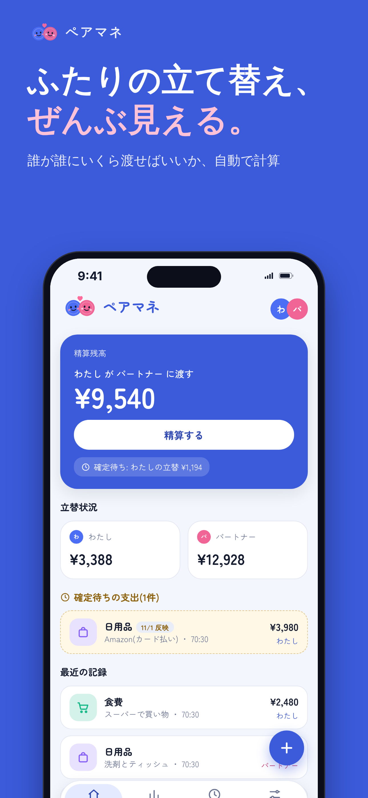

# ペアマネ

旧名は「おあいこ」。

ふたりの立て替えを記録して、「誰が誰にいくら渡せばいいか」を自動で計算する、ふたり専用の精算アプリです。iPhoneのホーム画面に追加して使うWebアプリ（PWA）で、データはFirebaseに保存され、ふたりの端末で同期されます。

- アプリ: https://nehaokn.github.io/pairmane/
- 一般公開はしない方針です。使うのは、招待コードでつながったふたりだけです。



## できること

- 支出の記録（金額・日付・払った人・カテゴリ・メモ）
- 負担の分け方: 割合（基本70:30、支出ごとに変更可）・金額指定・全額どちらか・個人負担
- あとで精算（カード払いなど。反映日までは精算残高に入らない）
- 精算の確定（精算済みにして履歴に残し、残高を0に戻す）
- 履歴（月ごと・検索）、精算履歴
- レポート（月の合計・ふたりの負担額・カテゴリ別グラフ・6か月推移・予算の使用状況）
- 固定費の自動登録（毎月の指定日以降にアプリを開くと記録）
- カテゴリの追加、カテゴリごとの月の予算（80%超でホームに警告）
- アプリ内の通知（パートナーの追加を、開いているときは画面上部、閉じていた間の分は次に開いたときホームに表示）
- 招待コードでの接続と「招待を送る」（共有シート）
- 引き継ぎ用アカウント（メール＋パスワード）。機種変更後も同じ接続に戻れる
- テーマ（ライト・ダーク・端末に合わせる）、フォント（ゆったり・すっきり・しっとり）。端末ごとの設定
- 機能追加・要望メモ（ふたりで共有）、使い方ページ

## 構成

| ファイル | 役割 |
|---|---|
| `index.html` | アプリ本体。HTML・CSS・JSを1ファイルにまとめ、ビルド不要 |
| `sw.js` | Service Worker。ネットワーク優先で、オフライン時はキャッシュを使う |
| `manifest.webmanifest`、`icon-*.png`、`apple-touch-icon.png` | ホーム画面追加用 |
| `firestore.rules` | Firestoreのセキュリティルール（正本）。Firebaseコンソールに貼って公開する |
| `docs/design.md` | 設計書（計算ロジック・データモデル・セキュリティ） |
| `docs/changelog.md` | 変更履歴と、見送った機能の理由 |
| `tests/` | 疑似Firebaseで動かす動作テスト |
| `tools/promo/` | 紹介画像・説明動画の作成スクリプト |
| `CLAUDE.md` | 次に改修するときのAI向けの作業メモ |

## 公開と設定

- **公開**: `main` ブランチのルートをGitHub Pagesで配信。`main` にpushすると1〜2分で反映されます。
- **Firebase**（プロジェクト `oaiko-cda99`、無料のSparkプラン）
  - Authentication: 「匿名」と「メール/パスワード」を有効にする
  - Authentication → 設定 → 承認済みドメインに `nehaokn.github.io` を追加
  - Firestore: 東京（asia-northeast1）。ルールは `firestore.rules` を貼って公開
- **ルールを変えるとき**: 新しいフィールドを書き込む版のアプリを出す前に、先にルールをFirebaseコンソールで公開します。逆の順番にすると、保存が失敗します。

## はじめかた（ふたりの端末）

1. SafariでアプリのURLを開き、共有ボタンから「ホーム画面に追加」を押す
2. 必ずホーム画面のアイコンから開く（Safariとホーム画面アプリは保存場所が別）
3. 1人が「新しく始める」で作成し、表示された8文字の招待コードを送る
4. もう1人が「招待コードで参加する」に入力する
5. 設定画面の「引き継ぎ用アカウント」で、ふたりともメールとパスワードを登録しておく

## 動作テスト

```sh
# Playwright と Chromium が必要
node tests/smoke.mjs
```

本物のFirebaseには接続せず、`tests/stub-*.js`（メモリ上の疑似Firebase）で動かします。
